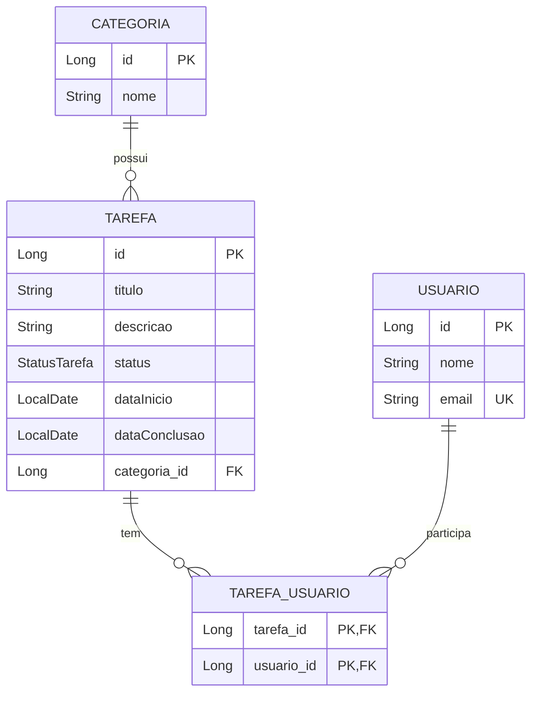

# Modelo de Domínio

Ver [[00-Indice]] · [[01-Decisoes-de-Design]] para o porquê do relacionamento ser unidirecional.

## Regras

- Uma `Categoria` pode estar associada a várias `Tarefa`.
- Uma `Tarefa` pertence a exatamente uma `Categoria` (`categoria_id` não nulo).
- `StatusTarefa`: `INICIADO`, `EM_ANDAMENTO`, `FINALIZADO`.
- Não é possível excluir uma `Categoria` que ainda tenha `Tarefa` vinculadas (ver [[01-Decisoes-de-Design]]).

## Usuário ⟷ Tarefa (N:M)

- Uma `Tarefa` pode ter vários `Usuario` e um `Usuario` pode estar em várias `Tarefa`.
- A tabela de junção `tarefa_usuario` guarda só as duas FKs (a chave primária é o par).
- `Tarefa` é o **lado dono** (`@ManyToMany` + `@JoinTable`); `Usuario` não tem lista de tarefas.
- `Usuario.email` é único (comparado em minúsculas, sem espaços nas pontas).
- Não é possível excluir um `Usuario` que ainda esteja vinculado a alguma `Tarefa`; excluir uma `Tarefa` remove seus vínculos, mas não os usuários.

Ver [[01-Decisoes-de-Design]] para o porquê de cada escolha e [[04-Roadmap]] para as próximas fases.
